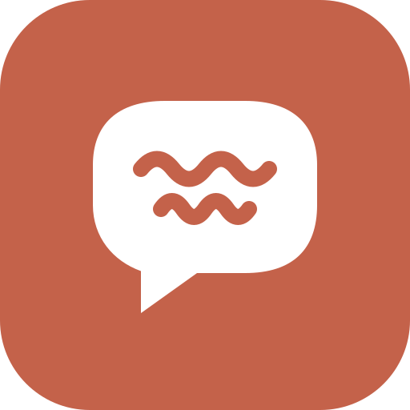
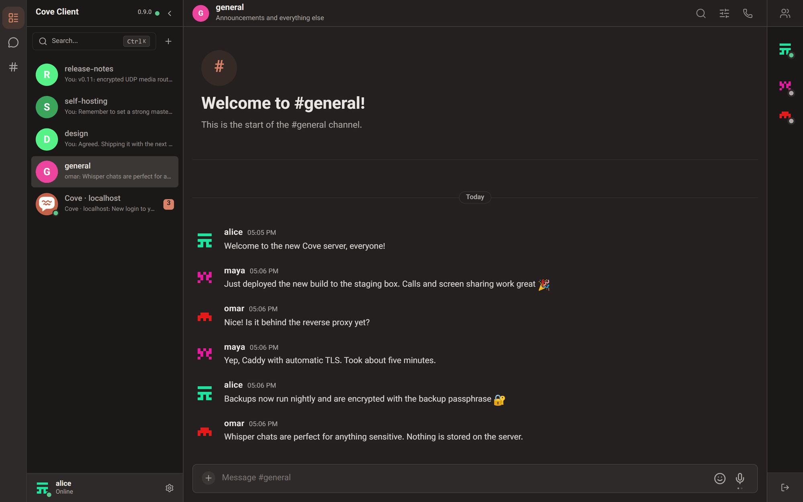
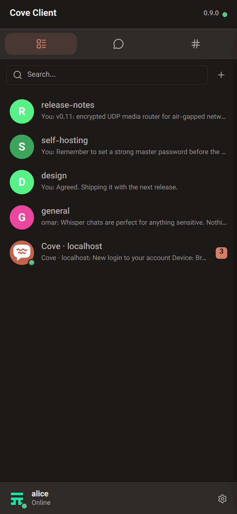
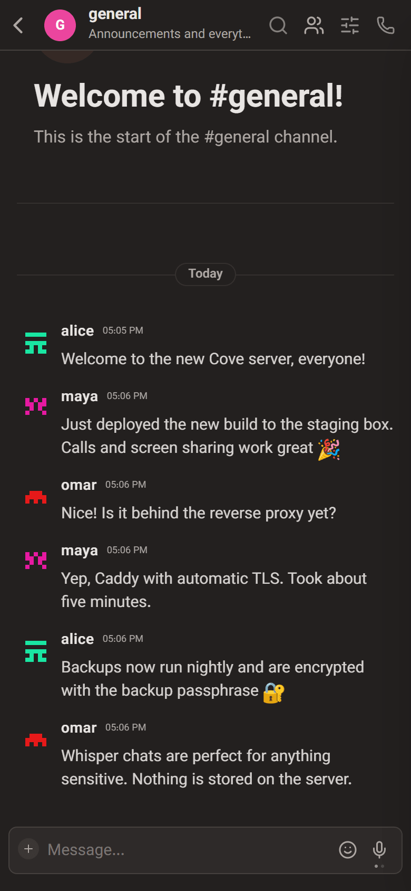
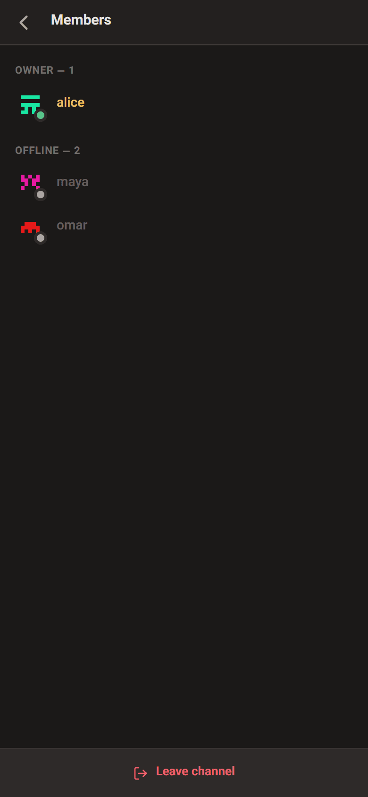
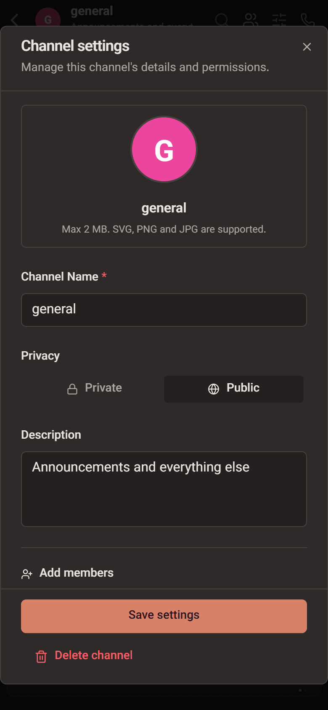
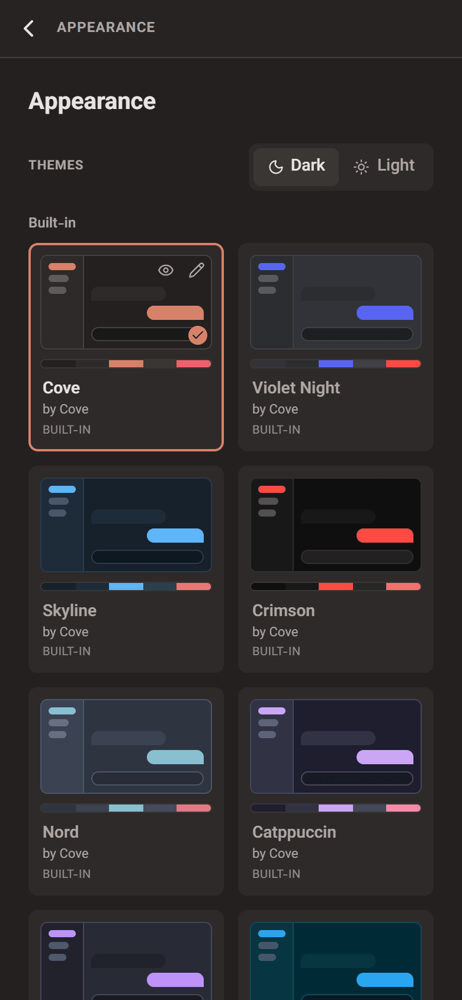
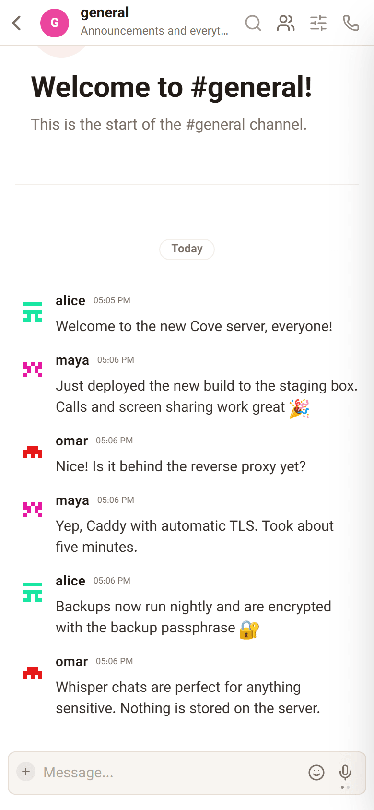

<div align="center">



# Cove

**Self-hosted encrypted chat. Messages, group calls and screen sharing on your own server.**

[](LICENSE)
[](https://github.com/mjn81/cove-chat/releases)
[](https://github.com/mjn81/cove-chat/actions/workflows/ci.yml)
[](backend)
[](client-web)
[](client-android)
[](DOCKER.md)

[Website](https://covechat.dev) ·
[Documentation](https://covechat.dev/docs/) ·
[Quick start](#quick-start) ·
[Releases](https://github.com/mjn81/cove-chat/releases) ·
[Contributing](CONTRIBUTING.md)

<br />



</div>

---

## Why Cove

Cove is a chat platform for communities that want to own their data. You run one small Go server, point the web, desktop and Android clients at it, and everything (accounts, history, files, calls) stays on your hardware. No accounts on someone else's cloud, no telemetry.

- **Your server, your data.** One binary or one `docker compose up`. The database is encrypted at rest.
- **Encrypted by design.** Messages are encrypted in the client with AES-256-GCM; the server only routes and stores ciphertext.
- **Calls included.** Group audio, video and screen sharing through a built-in WebRTC SFU, with embedded STUN/TURN. No third-party services.
- **Everywhere.** Web, desktop (Wails) and native Android clients.
- **Multilingual.** English, Persian and Arabic, with RTL layout support.

## Screenshots

<table>
  <tr>
    <td align="center"><br /><sub>Conversations</sub></td>
    <td align="center"><br /><sub>Channel chat</sub></td>
    <td align="center"><br /><sub>Members</sub></td>
  </tr>
  <tr>
    <td align="center"><br /><sub>Channel settings</sub></td>
    <td align="center"><br /><sub>Built-in themes</sub></td>
    <td align="center"><br /><sub>Light theme</sub></td>
  </tr>
</table>

## Features

| | Feature |
|---|---|
| 💬 | Direct messages and channels (public or private), replies, edits, deletes, presence |
| 🔐 | AES-256-GCM client-side message encryption, Argon2id key derivation, encrypted database |
| 🤫 | **Whisper** chats: zero-persistence end-to-end encrypted conversations |
| 📞 | Group audio/video calls and screen sharing (WebRTC SFU), plus an encrypted UDP router for air-gapped LANs |
| 🎙️ | Voice notes, file uploads, emoji and sticker packs |
| 🤖 | [Bots API](docs/bots-api.md) for automations and integrations |
| 🎨 | Light/dark themes, chat wallpapers, [custom themes](docs/covetheme-format.md) |
| 🌍 | Full i18n: EN / FA / AR |
| 🛡️ | Roles (owner, admin, member), invite-only or closed registration, sign-up protection, audit logs |
| 🛠️ | Admin panel, encrypted backups and restore, auto-update support |
| 📜 | Documented [REST API](docs/api-standard.md) with Swagger |

## Platforms

| Client | Stack | Status |
|---|---|---|
| **Web** | React 19, Vite, TypeScript, Tailwind, Shadcn | ✅ Primary |
| **Desktop** | Wails shell embedding the web client | ✅ Available |
| **Android** | Kotlin, Jetpack Compose, Stream WebRTC | ✅ Available |
| **Server** | Go 1.25, BadgerDB, Pion WebRTC | ✅ Linux, macOS, Windows, Docker |

## Quick start

### Docker (recommended)

Pre-built images are published. A ready-to-use setup lives in [`examples/docker-compose/production`](examples/docker-compose/production/):

```bash
cd examples/docker-compose/production
docker compose up -d
```

To build from source instead, use the root `docker-compose.yml`:

```bash
docker compose up -d --build
```

The **first account you register becomes the server owner.** See [DOCKER.md](DOCKER.md) for details and the [`examples/`](examples/) directory for more setups (reverse proxy, TLS, bots).

### From source

Requirements: Go 1.25+, Node.js with `corepack` (pnpm), and `make`.

```bash
make front/install   # install web dependencies
make dev-back        # backend on :8080
make dev-front       # web client (Vite)
```

Run `make help` to list every target.

### Desktop and Android

```bash
make wails/build          # desktop app for your OS
make android/install      # build and install the Android debug APK
```

See [desktop_build_guide.md](desktop_build_guide.md) and the [client docs](https://covechat.dev/docs/clients/connect/).

## Architecture

```
cove/
├── backend/            Go server
│   ├── cmd/server/       entry point
│   └── internal/
│       ├── api/            REST handlers (Swagger-annotated)
│       ├── ws/             WebSocket hub and signaling
│       ├── rtc/            WebRTC SFU + embedded STUN/TURN (default calls)
│       ├── mediarouter/    encrypted UDP media for air-gapped setups
│       ├── store/ db/      repository layer over encrypted BadgerDB
│       ├── auth/ crypto/   sessions, CSRF, Argon2id, AES-256-GCM
│       └── ...             config, middleware, packs, logger
├── client-web/         React + Vite + TypeScript
├── client-android/     Kotlin + Jetpack Compose
├── client-desktop/     Wails shell around the web build
├── website/            Astro docs site (covechat.dev)
└── docs/               protocol and design documents
```

### Security model

Cove uses **server-trusted encryption**. The server is the authority for key management, which keeps multi-device use and recovery simple.

1. A master password derives the **Key Encryption Key (KEK)** with Argon2id.
2. The database is encrypted at rest with a **Data Encryption Key (DEK)** wrapped by the KEK.
3. Each channel has its own AES-256 key, generated by the server, stored wrapped by the KEK and distributed to members.
4. Clients encrypt messages before sending; the server stores and routes ciphertext.

> [!NOTE]
> The server holds the channel keys, so it is inside the trust boundary. For conversations the server must never be able to read, use **Whisper** chats. Read the full [encryption model](https://covechat.dev/docs/security/encryption-model/) and [hardening checklist](https://covechat.dev/docs/security/hardening-checklist/).

## Configuration

Settings live in `config.toml` (and `COVE_*` environment variables).

| Section | Key | Description |
|---|---|---|
| `server` | `http_port` | API and WebSocket port (default `8080`) |
| `server` | `udp_port` | Encrypted UDP media port, only when `voice.mode = "raw_udp"` (default `9090`) |
| `voice` | `mode` | `webrtc` (default) or `raw_udp` for air-gapped networks |
| `registration` | `mode` | `open`, `invite_only` or `closed` |
| `security` | `master_password` | Master key for all encryption |
| `database` | `path` | BadgerDB storage path |

Full list: [configuration reference](https://covechat.dev/docs/configuration/reference/).

## Administration

Owners and admins get a **Server admin** panel in Settings: registration mode and invite codes, whitelisted `config.toml` edits, encrypted backups, data reset and more. The API enforces roles on every request.

- **Restore a backup:** with the server stopped, run `COVE_BACKUP_PASSPHRASE=... ./server restore file.cove-backup` against an empty data directory (`--force` merges into existing data).
- **Lost owner login:** set `[admin] owner_username = "name"` and restart.

More in the [administration docs](https://covechat.dev/docs/administration/admin-panel/).

## Documentation

| | |
|---|---|
| [Quick start](https://covechat.dev/docs/getting-started/quick-start/) | Docker in five minutes |
| [Self-hosting](https://covechat.dev/docs/self-hosting/docker/) | Docker, binary, reverse proxy, TLS, backups |
| [Bots API](docs/bots-api.md) | Build integrations |
| [API standard](docs/api-standard.md) | Wire contract for clients |
| [UDP media protocol](docs/udp-media.md) | Air-gapped calling |
| [Android parity](docs/android-parity.md) | Web vs Android feature status |

## Contributing

Contributions are welcome. Start with [CONTRIBUTING.md](CONTRIBUTING.md) and look for issues labelled `good first issue`.

```bash
make test             # backend tests (race detector)
make lint             # golangci-lint
make front/typecheck  # web type check
make front/lint
make front/test
```

Please also read the [Code of Conduct](CODE_OF_CONDUCT.md). To report a vulnerability, follow [SECURITY.md](SECURITY.md) rather than opening a public issue.

## Roadmap

| Phase | Milestone | Status |
|---|---|---|
| 5 | Wails desktop, encrypted UDP media router | ✅ Completed |
| 6 | Inter-node federation | 🔜 Planned |
| 7 | Production hardening: mTLS, audit logs | 🔜 In progress |

The detailed list is in [TODO.md](TODO.md); release history is in the [CHANGELOG](CHANGELOG.md).

## License

[MIT](LICENSE) © mjn

<div align="center">
<sub>Built with care for communities that value control over their own data.</sub>
</div>
